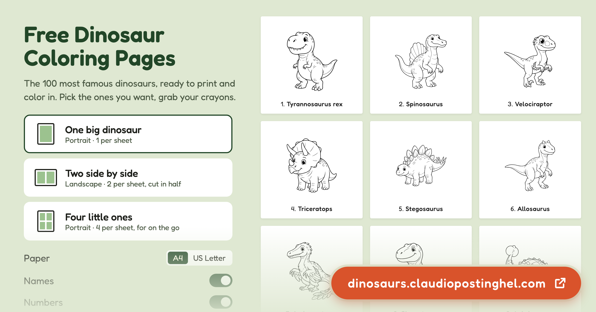

# Free Dinosaur Coloring Pages

Free printable dinosaur coloring pages for kids: the 100 most famous dinosaurs, from
Tyrannosaurus rex and Triceratops to Velociraptor and Stegosaurus, drawn with clean black
outlines, round friendly shapes and big closed areas that are easy to fill with crayons or
markers. Pick the ones you want, choose one, two or four per sheet, and print them on
A4 or US Letter paper straight from the browser. No sign-up, no ads, nothing to install.

Do whatever you like with them. Just don't sell them, or my lawyer, Attorneysaurus Rex,
will be on your tracks. 🦖

---

### Print layouts

- **One big dinosaur**: portrait, one drawing per sheet, the biggest size for little hands.
- **Two side by side**: landscape, two per sheet, to cut in half.
- **Four little ones**: portrait, four per sheet, handy for travel, restaurants and goody bags.

### Print options

- A4 or US Letter paper.
- Show or hide each dinosaur's name and its number.
- Dashed cutting lines between the drawings, on or off.

### Choosing the dinosaurs

- Print them all, or just the 10, 20, 30 or more most famous ones.
- Pick them one by one: tap a dinosaur to add it or leave it out.
- The browser can remember which ones you have already printed and skip them next time,
  so you always get new pages. You can make it forget at any time.

### Single drawings

- Print one dinosaur on its own.
- Download any drawing as a vector SVG (sharp at any size, even poster size) or as a JPEG.

### Who it is for

Parents, grandparents, teachers, preschools, schools and anyone with a dinosaur-crazy kid
and a printer: for a rainy afternoon, a classroom activity, a birthday party or a long
car ride.

### Which dinosaurs

The list is ranked by how often each dinosaur's Wikipedia page was read over the last year, so the most famous ones come first.

1. Tyrannosaurus rex
2. Spinosaurus
3. Velociraptor
4. Triceratops
5. Stegosaurus
6. Allosaurus
7. Archaeopteryx
8. Giganotosaurus
9. Ankylosaurus
10. Brachiosaurus
11. Dilophosaurus
12. Therizinosaurus
13. Deinonychus (coming soon)
14. Carnotaurus
15. Parasaurolophus
16. Argentinosaurus
17. Utahraptor (coming soon)
18. Brontosaurus
19. Diplodocus
20. Pachycephalosaurus
21. Nigersaurus (coming soon)
22. Iguanodon
23. Nanotyrannus (coming soon)
24. Apatosaurus (coming soon)
25. Titanosaurus (coming soon)
26. Megalosaurus (coming soon)
27. Yutyrannus (coming soon)
28. Carcharodontosaurus (coming soon)
29. Achelousaurus (coming soon)
30. Baryonyx
31. Compsognathus
32. Borealopelta (coming soon)
33. Ceratosaurus (coming soon)
34. Patagotitan (coming soon)
35. Herrerasaurus (coming soon)
36. Edmontosaurus (coming soon)
37. Microraptor (coming soon)
38. Troodon (coming soon)
39. Acrocanthosaurus (coming soon)
40. Suchomimus (coming soon)
41. Tarbosaurus (coming soon)
42. Coelophysis (coming soon)
43. Deinocheirus (coming soon)
44. Albertosaurus (coming soon)
45. Styracosaurus (coming soon)
46. Aquilops (coming soon)
47. Bruhathkayosaurus (coming soon)
48. Dreadnoughtus (coming soon)
49. Irritator (coming soon)
50. Protoceratops (coming soon)
51. Psittacosaurus (coming soon)
52. Maip (coming soon)
53. Gorgosaurus (coming soon)
54. Maiasaura (coming soon)
55. Massospondylus (coming soon)
56. Gallimimus
57. Camarasaurus (coming soon)
58. Mamenchisaurus (coming soon)
59. Oviraptor
60. Majungasaurus (coming soon)
61. Sinosauropteryx (coming soon)
62. Daspletosaurus (coming soon)
63. Sauroposeidon (coming soon)
64. Cryolophosaurus (coming soon)
65. Plateosaurus (coming soon)
66. Alamosaurus (coming soon)
67. Torvosaurus (coming soon)
68. Anchiornis (coming soon)
69. Amargasaurus (coming soon)
70. Pyroraptor (coming soon)
71. Nanuqsaurus (coming soon)
72. Concavenator (coming soon)
73. Saurolophus (coming soon)
74. Yi (coming soon)
75. Rajasaurus (coming soon)
76. Tyrannotitan (coming soon)
77. Saurophaganax (coming soon)
78. Pachyrhinosaurus (coming soon)
79. Giraffatitan (coming soon)
80. Mapusaurus (coming soon)
81. Hadrosaurus (coming soon)
82. Dryptosaurus (coming soon)
83. Megaraptor (coming soon)
84. Australovenator (coming soon)
85. Eoraptor (coming soon)
86. Kentrosaurus (coming soon)
87. Torosaurus (coming soon)
88. Ornithomimus (coming soon)
89. Austroraptor (coming soon)
90. Achillobator (coming soon)
91. Liliensternus (coming soon)
92. Dromaeosaurus (coming soon)
93. Struthiomimus (coming soon)
94. Dakotaraptor (coming soon)
95. Supersaurus (coming soon)
96. Guanlong (coming soon)
97. Muttaburrasaurus (coming soon)
98. Nyasasaurus (coming soon)
99. Procompsognathus (coming soon)
100. Hypsilophodon (coming soon)

### License

Everything here is under [CC BY-NC 4.0](LICENSE): free to use, share and adapt with credit,
just not to sell.
